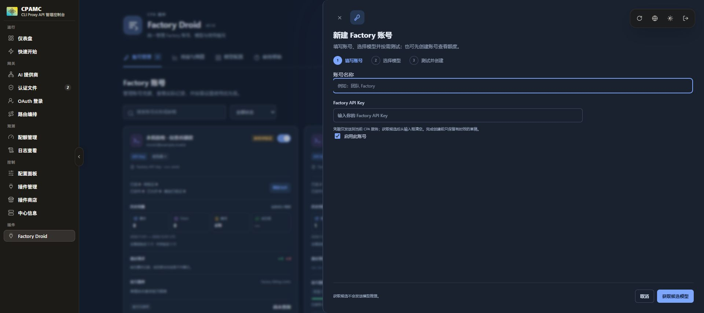

# Factory Droid

将 Factory 账号接入 CLIProxyAPI（CPA）的原生插件。插件 ID 为 `factory-droid`，通过 `factory/` 前缀发布模型，提供 API Key 账号管理、请求转发、官方额度与消耗查询，以及本地用量和预算估算。

当前版本为 `0.1.0`。Windows x64 已在本机 CPA v8.0.52 完成安装、健康检查与资源指纹核对；后台受控 Mock 场景属于阶段验证证据，最新界面的获取候选、测试和创建流程尚未完整验收。当前交付为本地安装包，GitHub Release 和远程商店安装尚未发布、验证。真实 Factory 账号、模型权限及官方额度读取仍待验证。

## 功能与边界

- 在插件页面添加、验证、启停、删除 Factory API Key，设置账号名称与路由优先级。
- 仅转发与模型配置协议匹配的原生 Messages、Responses 或 Chat Completions 请求、响应和 SSE；六种跨协议错配返回 400 `protocol_mismatch`，不发送 Factory 请求。
- 使用独立安装的官方 Droid CLI 读取候选目录；候选不是账号权限证明。没有 CLI 时，可手工选择已配置的明确原生路由。
- 按账号选择模型、显式发送基础测试并允许，再确认 CPA 实际发布。新建账号可不选模型，也可保存待验证模型。
- 为账号设置模型调用别名及输入、输出、缓存读取、缓存写入四项估算价格；不改其他账号或全局价格。
- 尝试读取 Factory 官方滚动限额与个人 Analytics 消耗。无权限、查询失败或字段无法识别时保留未知状态。
- 账号页展示请求、成功率、最近请求和每官方周期的本地 M / USD；后端另保留业务/验证统计、报表窗口及预算 API。
- 有足够官方额度快照和完整本地样本时，按额度池与窗口推算总容量及剩余 token / 费用；条件不满足时显示未知。

授权方式为 Factory API Key。当前版本不提供设备码 OAuth、access/refresh token 导入或 CLI/SDK 推理备用通道。API Key 没有插件代为刷新的流程；撤销或到期后需更新授权。

模型调用使用 Droid 客户端的私有 HTTP 接口，可能随 Factory 更新而变化；它不是 Factory 承诺稳定的公开推理 API。内置模型定义与 CLI 候选都不代表账号已有权限。基础测试只证明某时点的短文本调用成功，不证明工具、图片等全部能力或未来权限。精确 token 预计算接口未实现。

## 界面预览

以下为**本地模拟验证界面**，账号、FSC、额度百分比与预测值来自 Mock 数据，不是真实 Factory 账号或额度证据。

宿主管理中心截图保留的是此前 1040px 三步抽屉的历史画面，不代表当前 640px 连续表单。最新界面与未完成项见 [验证记录](docs/validation.md)。



宿主中的抽屉与键盘验收见 [前端宿主验收](docs/frontend-ui-acceptance.md)；[移动端截图](docs/images/factory-account-drawer-host-mobile.png) 和 [模型选择截图](docs/images/factory-account-drawer-models-host.png) 同样来自本地模拟环境。

## 运行要求与管理端兼容性

- CPA 基线为 **v8.0.52**。插件使用原生 C ABI 1、RPC schema 10，需要带 **CGO 原生插件支持**的 CPA 构建。
- 发布流水线配置 Windows x64 和 Linux x64；不声明其他平台已经验收。
- Windows x64：DLL 动态依赖 `VCRUNTIME140` 与 UCRT，需要安装 **Microsoft Visual C++ v14 Redistributable x64**，版本不低于构建所用的 MSVC 14.44。下载及支持版本见 [Microsoft 官方说明](https://learn.microsoft.com/en-us/cpp/windows/latest-supported-vc-redist?view=msvc-170)。
- Linux x64：以 **Ubuntu 22.04 / GLIBC 2.35** 为运行基线。CI 使用 `readelf` 检查 `.so` 的最高 GLIBC 导入版本不超过 2.35；未声明 musl 或更早 GLIBC 的兼容性。
- Factory API Key（`fk-` 开头）、可访问 Factory 的 CPA 出站网络，以及当前 CPA 的管理密钥。
- **官方 Droid CLI 是可选的独立依赖，仅用于候选发现**。插件 ZIP 不包含 CLI，不自动下载或安装，也不需要为插件运行额外安装 Node.js。未配置 CLI 仍可手工选择明确模型路由并测试。

当前适配场景包含 `seakee/CPA-Manager-Plus v1.14.10`。该管理端原有额度页面按 provider 固定实现，不能直接把 Factory 额度画成原生卡片；请从 **Factory Droid 插件页面**查看对应账号、官方限额和消耗。通用用量统计继续由 CPA 的 usage 机制处理，插件不读取会与其他消费者竞争事件的 `usage-queue`。

具体通过与未通过的验证项目见 [验证记录](docs/validation.md)。

## 本地安装（Windows x64 已实装验证）

1. 使用本地 `release/` 中对应系统的 ZIP，或按下文从源码构建。Linux x64 使用相应产物，运行要求见上节。
2. 解压，将 ZIP 根目录的 `factory-droid.dll`（Windows）或 `factory-droid.so`（Linux）放入 CPA 的 `plugins` 目录。不要直接复制 Cargo 产物的 crate 文件名。
3. 在 CPA 配置中合并下列片段，保留已有插件配置：

   ```yaml
   plugins:
     enabled: true
     dir: "plugins"
     configs:
       factory-droid:
         enabled: true
         data-dir: "data/factory-droid"
   ```

4. 重启 CPA，确认插件列表中出现 `Factory Droid`，再从插件菜单打开页面。

`data-dir` 相对于 CPA 进程的工作目录，用于保存脱敏账号状态、设置和本地用量账本；它不是 Factory Key 的配置入口。Key 由 CPA 的 auth 存储保存，不应写入插件 YAML。

如果需要读取 CLI 候选目录，先按 [Factory 官方 CLI 文档](https://docs.factory.com/reference/cli-reference) 独立安装 Droid，取得原生可执行文件的绝对路径，再补充插件配置。例如下面的路径只是占位示例，须替换成自己的安装位置：

```yaml
plugins:
  configs:
    factory-droid:
      droid-cli-path: "C:/Tools/Factory/droid.exe"
      discovery-timeout-seconds: 30
```

Linux 同样填写实际原生可执行文件的绝对路径。不要填写 `.cmd`、`.bat`、JavaScript 脚本或 shell 包装器。CLI 在隔离目录运行，不复用用户既有 Factory 登录配置；配置后重启插件。

可选的插件配置：

| 字段 | 默认值 | 用途 |
| --- | --- | --- |
| `data-dir` | `data/factory-droid` | 状态与用量账本目录，需可写 |
| `factory-client-version` | `0.242.0` | 请求携带的 Droid 客户端版本；修改前应验证上游协议 |
| `droid-cli-path` | 未配置 | 官方 Droid 原生可执行文件的绝对路径，仅用于读取候选 |
| `discovery-timeout-seconds` | `30` | 候选发现超时，范围 10–120 秒 |
| `api-base-url` | `https://api.factory.ai` | Factory API 地址，仅接受受信任 Factory HTTPS 域名 |
| `allow-local-mock` | `false` | 开发联调开关，仅在显式开启时允许本机模拟服务 |

数据目录或网络配置变更需要重启插件。正常使用不需要配置模拟服务。

## 商店安装（远程尚未发布）

本仓库提供 CPA schema 1 插件源。待代码和对应版本的 GitHub Release 发布后，在 CPA 插件商店添加以下源，或合并配置：

```yaml
plugins:
  enabled: true
  store-sources:
    - "https://raw.githubusercontent.com/junxin367/cpa-factory-droid/main/registry.json"
```

刷新商店，选择 `Factory Droid`，完成管理端显示的第三方插件确认后安装并启用。添加源不会自动创建 Release；若版本没有对应 ZIP 或 `checksums.txt`，安装不能完成。

`0.1.0` 发布产物约定：

| 平台 | ZIP | ZIP 根目录动态库 |
| --- | --- | --- |
| Windows x64 | `factory-droid_0.1.0_windows_amd64.zip` | `factory-droid.dll` |
| Linux x64 | `factory-droid_0.1.0_linux_amd64.zip` | `factory-droid.so` |

商店按 `checksums.txt` 校验 ZIP 的 SHA-256；ZIP 内另有动态库的 `SHA256SUMS.txt`。

## 新建账号、选择模型与测试

1. 页面优先复用当前同源管理器已保存的会话。未保存或无法复用时点击“管理授权”：**直连 CPA 填写 CPA 管理 Key，CPAMP Full Mode 填写当前 Admin Key**。手工输入值仅保留在当前页面内存，不另行持久保存。
2. 点击“新建”，在同一右侧抽屉填写名称和 **Factory API Key**。服务端验证身份后建立内存草稿，创建前不写 CPA 凭据文件、不发布模型。
3. 可直接创建零模型账号，稍后读取额度或配置模型。也可点击“获取模型”，在独立候选弹窗搜索、多选，再“添加所选”返回主抽屉；没有 CLI 时仅手工选择已配置的明确路由。获取候选会按官方目录和已核对注册表补齐可确认的原生模型配置，但不发送推理或自动允许调用；禁用、弃用、自定义、路由型及未支持协议的候选仍受阻。
4. 主抽屉用紧凑列表展示模型名称及本账号调用别名，价格按需展开。别名只改变 `factory/<account-id>/<alias>`，四项价格覆盖只用于本账号；留空继承全局。
5. 若要立即使用所选模型，明确确认额度消耗后通过测试菜单选择模型。**每个模型发送一次固定短请求，输出上限 128 token，会消耗模型额度。** 结果留在主抽屉，测试成功本身还不会发布草稿模型。
6. 点击“创建”。零模型、待验证或测试失败的选择均可保存；只发布账号启用、路由启用、允许意图和当前有效基础验证同时满足的模型。未验证项保留为待处理，不能调用。
7. 查看该账号模型管理抽屉中的实际发布状态，再从 `/v1/models` 或模型调用示例复制实际 ID。若显示发布待同步，重试发布同步，不要为同步问题重新付费测试。

保存账号后，可在账号卡片使用“验证 / 刷新”重新检查身份和读取官方额度。官方接口无权限时保持未知，不等于余额为零，也不直接表示模型调用不可用。账号设置可调整名称、启停和 `-100` 至 `100` 的路由优先级。

列表只显示 Key 末四位提示，管理接口不返回完整 Key。会话复用只读取当前来源适用的管理器登录记录，支持 `cli-proxy-auth` 的 v1 / v2 编码；不会将会话密钥再次写入浏览器或插件状态。管理器密钥和 Factory API Key 是两个独立字段。

草稿有效期 30 分钟，取消主抽屉中的新建、草稿过期或插件重启后需重新填写 Key；仅关闭候选选择弹窗会回到主抽屉。已发出的测试用量仍保留。创建返回同步错误时使用原草稿重试创建同步，不会重复创建账号或重新测试。详细状态、迁移和恢复方法见 [账号与模型管理](docs/models.md)。

已有账号点击卡片底部“模型管理”图标，进入该账号的模型管理抽屉，继续获取、验证、允许及重试发布同步。撤销允许会注销该账号对应目录，其他账号仍允许的共享模型保留。删除账号会停止该凭据路由并移除凭据，保留不含 Key 的历史用量。页面直接展示账号卡片，不设置 Tab 导航。

## 调用模型

客户端连接 **CPA 地址**，使用 **CPA 客户端 API Key**；Factory Key 已由插件后端使用。先通过 `/v1/models` 或账号抽屉确认实际发布的 `factory/` 模型 ID。

**按模型配置的 `protocol` 选择入口，不能仅看模型名称。** 共享模型和固定账号模型都沿用该映射的协议：

| 模型配置 `protocol` | 调用入口 | 示例模型 |
| --- | --- | --- |
| `anthropic` | `/v1/messages` | `factory/claude-opus-5-5` |
| `responses` | `/v1/responses` | `factory/gpt-5.4` |
| `chat_completions` | `/v1/chat/completions` | `factory/glm-5.3` |

以下均是 CPA 请求。把 `CPA_CLIENT_API_KEY` 替换为已配置的 CPA 客户端密钥，并使用自己的服务地址。示例模型仍须当前账号有权限且映射已启用。

Anthropic Messages：

```http
POST http://127.0.0.1:8317/v1/messages
Authorization: Bearer CPA_CLIENT_API_KEY
anthropic-version: 2023-06-01
Content-Type: application/json

{
  "model": "factory/claude-opus-5-5",
  "messages": [{"role": "user", "content": "请用一句话介绍你自己。"}],
  "max_tokens": 128,
  "stream": false
}
```

OpenAI Responses：

```http
POST http://127.0.0.1:8317/v1/responses
Authorization: Bearer CPA_CLIENT_API_KEY
Content-Type: application/json

{
  "model": "factory/gpt-5.4",
  "input": "请用一句话介绍你自己。",
  "max_output_tokens": 128,
  "store": false,
  "stream": false
}
```

OpenAI Chat Completions：

```http
POST http://127.0.0.1:8317/v1/chat/completions
Authorization: Bearer CPA_CLIENT_API_KEY
Content-Type: application/json

{
  "model": "factory/glm-5.3",
  "messages": [{"role": "user", "content": "请用一句话介绍你自己。"}],
  "max_tokens": 128,
  "stream": false
}
```

需要 SSE 时在对应原生请求中设置 `"stream": true`。“添加映射”中的协议同时决定允许的客户端入口与 Factory 上游路径；更换模型不能让插件代为转换 body。停用全部 Factory 账号后，不应继续将这些模型视为可调用。

每个账号还会提供 `factory/<account-id>/<模型后缀>` 形式的固定账号模型，用于主动选择账号。这是可选路由能力，不是工具调用的必需步骤。从账号的实际发布模型、`/v1/models` 或账号数据的 `pinned_models` 取得 ID。固定 ID 仍使用原映射对应的入口。

图片能力由模型映射的 `supports_images` 声明，未声明时默认为 `false`；内置 **GLM-5.3 仅支持文本**。自定义映射应按实际上游能力设置该字段，不要仅因协议能够编码图片就声明模型支持。

原生工具 ID、签名、redacted / encrypted 内容、cache 与 usage 字段按原协议保留，客户端用原协议完整续接工具历史。Factory 必需的模型名、Droid identity、认证和路由头会作相应处理。

CPA v8.0.52 存在两项已确认边界：插件 hook 前可能把误投 Chat 入口的 Responses 形状 body 改成 Chat并丢弃原文；Chat 自定义 `event:` 在前的 SSE 帧会被宿主重新包装，改变事件语义。标准 Chat `data:` 帧正常，但不能承诺所有 SSE 或端到端字节透明。本项目不修改宿主，详见 [原生协议与调用限制](docs/protocol.md)。

## 额度、消耗与预测如何理解

卡片顶部的请求、Token、费用和成功率使用同一个 `account.usage` 报表窗口，默认 UTC 自然月或后端配置的自定义范围，包含基础验证；它们不是账号全历史或官方账单。最近请求条只显示该范围的最近子集。

下方按官方周期展示紧凑额度行：周期标签、剩余百分比、细条，蓝色组为“本插件已用 USD / 已用 M Token”，紫色组为“预计周期总 USD / 预计周期总 M Token”，并显示重置倒计时。预计值带“≈”，缺价、缺 usage 或样本不足显示“—”；Droid Core 5 小时行隐藏，后端数据不变。

| 页面数据 | 来源与单位 | 窗口与限制 |
| --- | --- | --- |
| Factory 官方限额 | 私有 `/api/billing/limits` 返回的已用百分比 | 按 Standard / Core 的 5 小时、7 天、30 天滚动窗口分别展示；有返回才显示 |
| 官方额外用量余额 | 同接口的 `extraUsageBalanceCents / 100`，USD | 与滚动窗口百分比独立，缺失时未知 |
| Factory 官方消耗 | 公开个人 Analytics 返回的 FSC | 查询范围使用设置中的 UTC 日期；需 Enterprise 且启用 Analytics 等实际权限，不等于剩余额度 |
| 本地业务与验证用量 | 业务调用与显式模型测试分别记账 | 两者计入总预算；默认 UTC 自然月，可自定义窗口 |
| 每官方窗口的已记录 M / $ | 同账号、明确额度池、该官方窗口内的本地账本 | 主行要求对应记录完整；缺价或缺 usage 显示“—”，覆盖和已知部分保留在 API |
| 本地剩余预算 | 用户预算减去本地加权 token 消耗 | 仅全局应用；缺 usage 时剩余未知，不会自动拦截请求 |
| v2 样本容量估算 | 同账号、池和精确官方周期的两次快照差分 | 是推算的原始 token / USD 容量，不是官方余额 |

API Key 是否能读到官方限额取决于当前接口与账号权限。独立客户端存在成功实现与历史 401 记录，应以本次查询结果为准，不能一概认定支持或不支持。官方 FSC、百分比和本地加权 token 不可直接相减。

本地加权公式为：

```text
（输入 token - 缓存读取 token - 缓存写入 token）× 输入倍率
+ 缓存读取 token × 缓存读取倍率
+ 缓存写入 token × 缓存写入倍率
+ 输出 token × 输出倍率
```

本地账本的输入 token 归一化为包含缓存读取与写入：Anthropic 原始 input 不含缓存，加入一次；Responses / 标准 Chat 的 input 已含缓存子集，不再叠加。reasoning 已含于输出，避免重复计费。美元估算按未缓存输入、缓存读取、缓存写入和输出分别使用单价；实际出现某类 token 而未配置该项价格时，费用保持未知。倍率与价格是本地估算配置，修改后用于新记账请求。缺少 usage 的成功请求只计次数；失败不计为成功 token 消耗。账本保留最近 400 天，展示范围还受所选统计窗口限制。

额度池只取可信 Factory 目录或管理员显式配置，不能按模型品牌或名称猜测；未知池记录不塞入 Standard / Core。每个官方窗口使用自己的起止时间统计，独立于全局报表窗口。`partial` 表示仅覆盖部分周期，`unknown` 表示边界或覆盖证据不足，都不等于完整零消费。

通过“验证 / 刷新”采集官方额度快照。v2 估算要求同一账号、明确额度池、相同窗口键及精确起止时间、同一账本代次的两次快照；已用比例增加至少 **0.5 个百分点**、期间至少 **100 个原始输入与输出 token**，且没有缺失 usage 或未知池记录。估算公式为：

```text
估算总 token = 期间本地输入与输出 token / 已用比例变化 × 100
估算剩余 token = 估算总 token × 官方剩余比例
```

费用按同一期间有完整价格的本地费用同比外推；区间外的旧缺价记录不会永久污染新样本。样本不足、窗口变化、缺少 usage 或官方接口不可读时保持未知。其他客户端消费、模型组合变化和百分比精度都会影响估算。Analytics 仅支持 UTC 日汇总，子日自定义窗口不会假算为零；详细口径见 [用量、窗口与估算](docs/usage.md)。

## 升级、停用与卸载

升级前备份 CPA 的 `auth-dir` 及插件 `data-dir`。商店安装的插件可通过商店升级；手动安装时先停用插件或停止 CPA，再替换对应动态库并重启。保留数据目录与账号凭据即可继续读取已有设置和本地账本。

从早期版本升级时，模型定义与历史账本保留，但缺少当前账号、组织、凭据和路由基础验证的旧模型不会自动发布；请在账号模型页重新明确测试并允许。旧账本没有可信额度池来源的记录保留 token / 费用，额度池标为未知。

暂时停用可以关闭插件或具体账号。彻底卸载时，先在插件页面删除账号并确认凭据已移除，再停用插件、移除动态库及对应配置。插件卸载不等于撤销 Factory 官方 Key；需要撤销时在 Factory 管理端操作。只有确认不再需要历史统计后，才删除插件数据目录。

一个 `data-dir` 只供一个 CPA 进程使用。账本为本地 JSON 持久化，更新会写临时文件并原子替换；不是多进程共享数据库。并发撤销、删除或改变凭据/路由后，迟到测试不会恢复允许状态，但已发送的测试仍可能产生消费。

## 开发与构建

需要 Rust 工具链（版本由 `rust-toolchain.toml` 固定）、PowerShell 7、Node.js 24。Windows 还需 MSVC C++ 构建工具；Linux x64 需要原生链接器，CI 构建系统固定为 Ubuntu 22.04。前端为内嵌 HTML / CSS / JavaScript，无需 npm 安装或前端构建服务。

在仓库根目录运行：

```powershell
cargo fmt --check
node --check web/app.js
node --check scripts/release.mjs
node scripts/release.mjs registry
cargo test --locked
./scripts/build.ps1 -Target x86_64-pc-windows-msvc -ReleaseAssets
```

Linux x64 在相应系统运行：

```powershell
./scripts/build.ps1 -Target x86_64-unknown-linux-gnu -ReleaseAssets
```

安装包写入 `release/`。构建脚本会从 Cargo 元数据定位 `cpa_factory_droid` 动态库，重命名为 CPA 插件文件名后打包，并检查根目录动态库、文档链接和校验和。ZIP 外的同名 `.build.json` 记录源码指纹、构建环境及产物信息，`.sha256` / `checksums.txt` 提供 ZIP 校验；ZIP 内 `SHA256SUMS.txt` 校验动态库。指定 `-Profile debug` 可生成带 `_debug` 后缀的本地包；它不能与 `-ReleaseAssets` 同时使用。

CI 在 Windows x64 / Linux x64 检查格式、测试和打包，并校验 Linux 产物的 GLIBC 导入基线。本地 Linux 构建也可运行 `node scripts/check-linux-runtime.mjs target/x86_64-unknown-linux-gnu/release/libcpa_factory_droid.so 2.35`，需要系统安装 `readelf`。发布工作流仅响应 `v*` 标签，并校验标签、Cargo 版本和 `registry.json` 一致；它还会生成 ZIP 校验和、发布说明和 `latest.json`。推送标签会触发发布，因此本地构建无需创建或推送标签。

实现结构与限制见 [架构说明](docs/architecture.md)，选型依据见 [调研记录](docs/research.md)。CPAMP 的历史统计、独立价格表和认证差异见 [Manager Plus 兼容说明](docs/manager-plus.md)。

## 许可证

[MIT](LICENSE)
