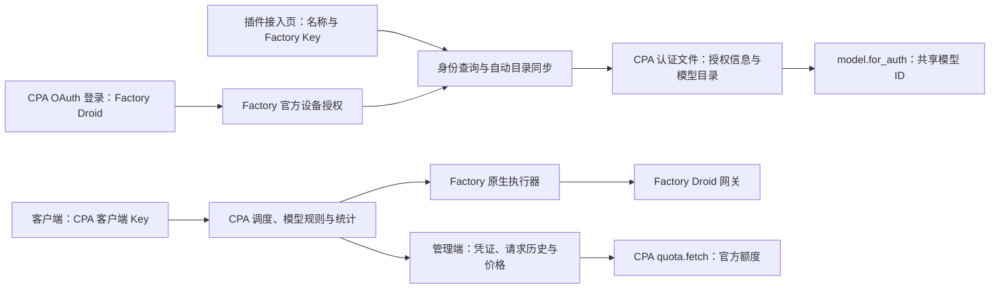

# 架构与数据说明

插件 ID / provider 为 `factory-droid`。Rust 包为 `cpa-factory-droid`，库 target 为 `cpa_factory_droid`，打包后重命名为 `factory-droid.dll` 或 `factory-droid.so`。

## 请求与存储

API Key 接入通过 `host.auth.save` 保存凭据；OAuth 由 `auth.login.poll` 返回 `AuthData`，交给 CPA 原生登录流程保存。完整 Key 和 OAuth 令牌只进入 CPA auth 存储。
新凭据的 `factory_catalog` 保存脱敏目录元数据，导入或重启时由 `model.for_auth` 恢复。
旧目录和价格、账本字段保留兼容读取，旧逐模型允许/验证状态不再决定可发布集合。

公共模型 ID 只有 `factory/<模型>`，不再为账号生成第二套 UUID 模型。原生凭据启停通过宿主模型加载钩子同步，实际调度和错误记录由 CPA 负责。
目录同步仍确认宿主实际发布集合；只有 supported 原生路由会发布，未知协议保持未发布。

## ABI 与生命周期

动态库导出 `cliproxy_plugin_init`，交换 `HostApi` / `PluginApi`。业务通过 JSON RPC envelope 传递；Go `[]byte` 字段按 Base64 编解码。宿主 callback 的返回缓冲区由宿主释放，插件返回缓冲区由插件释放，避免跨分配器释放。C 边界捕获 panic 并返回脱敏错误。

注册声明 auth、model、executor、quota、management 和请求拦截能力。原生契约声明实际需要的 RPC Schema 7；不使用 Schema 8 的原始字节补丁、Schema 9 的多提供商目录或 Schema 10 的多 OAuth 入口扩展。已验证 CPA v8.0.47（最高 Schema 8）和 v8.0.52（最高 Schema 10）；CGO 关闭的 CPA 不能加载这些原生动态库。

请求通过 `host.http.operation_open` 建立可取消操作，复用宿主 HTTP 与代理策略。模型推理的流式和非流式请求均不设置插件总时长上限，长上下文处理、长思考和持续输出不会因原来的 180 秒限制被插件中断；客户端取消和宿主请求生命周期仍然生效。旧状态与设置请求中的 `request_timeout_seconds` 仅兼容读取，不再生效或写回。流式执行先取得上游流和响应头，再由工作线程转发原生 chunks，并独立观察原生终态。身份、额度、OAuth 和基础连通性验证等管理操作保留各自的超时，且只取消本次 operation。quiesce / shutdown 取消活动操作和发现进程，等待收尾；仍未结束时返回 draining 状态，不假装旧请求已完成。本机验收范围见 [验证记录](validation.md)。

## 官方目录同步

`src/discovery.rs` 只运行管理员配置的原生 Droid CLI，读取 `droid.list_models`。
添加凭据和 `auth.refresh` 自动同步目录，不执行推理；账号权限由后续正常请求的 Factory 响应判断。
CLI 的隔离环境、超时、进程取消、敏感字段拒绝及最大输出限制保持不变。
禁用、废弃、自定义、自动路由和当前无法原生转发的模型不注册。

## 授权与管理页面

静态资源编译进动态库，资源前缀为 `/v0/resource/plugins/factory-droid`。资源只包含 HTML、JavaScript 和 CSS；所有账号及统计数据从受 CPA 管理鉴权保护的 `/v0/management/plugins/factory-droid` 接口获取。

页面优先复用当前同源管理器明确保存的会话，支持 `cli-proxy-auth` v1 / v2 编码，要求 `rememberPassword=true` 并检查 API 地址适用于当前 origin。未保存或无法复用时手工输入当前管理器密钥：直连 CPA 使用 CPA 管理 Key，CPAMP Full Mode 使用 Admin Key。插件不另行持久保存管理密钥。Factory Key 仅在接入表单填写；身份及目录读取成功后保存为 CPA 凭据。API 不返回完整 Key。

`auth.login.start` 创建 Factory WorkOS 设备授权，`auth.login.poll` 遵守上游轮询间隔并处理 pending、slow_down、拒绝和过期。确认组织、身份和区域后返回 CPA 原生凭据。设备码和待完成令牌仅保存在有时限的内存会话中。

`auth.refresh` 由 CPA 调度，按令牌实际到期时间提前续期。按凭证串行交换 refresh token，并复用并发请求的轮换结果；身份或目录接口临时故障不会丢弃已轮换令牌。令牌续期不依赖插件模型缓存先完成加载，也不覆盖同时发生的凭证停用或名称修改。详见 [OAuth 登录](oauth.md)。

## 原生协议门禁

三种模型配置分别绑定原生入口：`anthropic` → `/v1/messages` / `claude`，`responses` → `/v1/responses` / `openai-response`，`chat_completions` → `/v1/chat/completions` / `openai`。协议来自显式配置，不从模型名称推断。

插件同时声明上述三种 input / output format，让标准三入口精确选择自己的格式；这不构成允许跨协议的声明。`request.intercept_after` 在已选凭据和解析模型之后检查转换前 `SourceFormat`、`ToFormat`、所选 Factory auth、实际模型和请求路径。错配通过正常 RPC 结果中的显式终止响应返回 HTTP 400 `protocol_mismatch`，不发送 Factory 请求。

由于宿主会在普通 interceptor RPC 错误时继续请求，仅抛出错误不能作为门禁。匹配的 Factory 请求会取得绑定本次 auth / model / 原始格式 / stream / 路径的一次性内部校验凭证；executor 在任何 Factory HTTP 之前复核该凭证、输入格式、输出格式、路径与凭据。凭证最多 4096 项、有效期 60 秒，不落盘；缺少、过期或不匹配时拒绝执行，内部凭证不转发给 Factory。其他 provider 不受 Factory 模型规则约束。

鉴权后拦截阶段读取请求体，完成 Factory 身份、缓存与安全标识、默认参数和外层元数据处理，再交给 CPA 执行最终 payload 规则。一次性凭证只保留匿名会话和消息身份，不保存正文。执行器不再重新添加用户已过滤的字段或改写最终业务参数；仅将仍为当前 CPA 公共模型 ID 的字段解析为上游模型 ID，并将 SDK `betas` 选项消费到协议头。管理员的 payload 配置可覆盖默认封装，必须确保最终参数符合目标上游接口。

匹配时在同一协议内保留消息、工具 ID、签名、redacted / encrypted 内容、cache_control、usage 与原生 SSE，不重建为其他协议。Factory 必需的上游模型、Droid identity / system / instructions、认证/路由头，以及注册表明确要求的 Fast / Ultra Fast 参数按协议处理；与快速模式冲突的客户端参数明确报错。检查已有 stream 值与宿主执行方式一致；流式执行且原生 stream 缺失或为 null 时补为 true。工具历史由客户端按原协议完整提供。图片能力仍由模型配置 `supports_images` 声明。

出站封装集中在 `src/wire.rs`：采用官方 CLI 1.2.0 实测身份头，分别处理对话身份、缓存分组和安全标识，按 Factory 凭证及下游调用方隔离。`wire_namespace` 随插件状态持久化，使匿名 UUID 在重启和大量会话下保持稳定；不保存下游会话原文或逐会话映射表。消息 UUID 和 W3C traceparent 每次独立生成。移除外层客户端、代理、鉴权和追踪元数据，保留原生续接 ID、消息和工具内容。具体边界见 [会话与缓存审查](session-cache-review.md)。

CPA v8.0.52 有两项明确边界：所有插件 hook 之前可能把误投 Chat 入口的 Responses 形状 body 改成 Chat并丢弃原文；Chat event-first 自定义 SSE 帧会被内置 normalizer 和 HTTP writer 再包装，改变事件类型与 data 语义。标准 Chat data 帧正常。宿主还可能调整 model、thinking、payload rules 和 usage details。原生插件 ABI 无开关绕过上述 Chat writer，本项目不改宿主，不能承诺全 SSE 或端到端字节透明。完整范围见 [原生协议与调用限制](protocol.md)。

## 网络边界

添加或刷新账号时调用 whoami，读取 region、组织和 `premBaseHostV2`。Factory 返回的主机也经过域名校验；默认只允许 Factory HTTPS 域名。开发时需显式启用 `allow-local-mock` 才允许 localhost / 127.0.0.1 / ::1，不能用任意公网 URL 替代上游。

认证失败、模型权限错误、请求过大和限流分别保留相应 HTTP 错误语义；不把所有 403 认定为 Key 失效。已开始输出的流不应透明重放，避免重复输出或工具执行。此接口依赖私有 Droid 契约，客户端身份、请求头、模型路由和数据结构可能随上游变更。

## 统计与持久化

Factory 执行器返回原生 usage，CPA 负责统计及发布用量事件。插件关闭 `usage_plugin`，不再重复记账或维护面向用户的价格、预算与预测页面。
额度接口单独读取 Factory billing limits，不把请求统计或旧本地账本混入额度响应。

插件状态仍原子写入本地 JSON，保存兼容数据和脱敏目录缓存；一个数据目录不能由多个 CPA 进程并写。
CPA 管理端负责统计历史及价格，插件不消费 usage queue，不修改 Manager 价格表。

## 管理端与安装限制

CPA 官方管理前端有通用插件菜单和 quota 渲染；第三方管理端是否消费相同扩展需分别核查。`seakee/CPA-Manager-Plus v1.14.10` 原版按固定 provider 实现 quota 卡片；本仓库提供通用插件额度适配补丁，并已部署到本机 Manager。

商店注册表采用 CPA schema 1。ZIP 名遵循 `factory-droid_<version>_<goos>_<goarch>.zip`，动态库必须位于 ZIP 根目录，Release 提供校验和。发布矩阵覆盖 Windows x64、Linux x64、macOS Intel 与 Apple Silicon；四个平台通过真实 CPA 宿主的模拟上游回归后才公开 Release。注册表是安装描述，不能代替实际 Release 的存在。

Windows DLL 使用 MSVC 动态运行库，依赖 `VCRUNTIME140` / UCRT；安装环境需要 x64 Microsoft Visual C++ v14 Redistributable，版本不低于构建工具集 MSVC 14.44。Linux 在 Ubuntu 22.04 构建，CI 使用 `scripts/check-linux-runtime.mjs` 调用 `readelf`，断言最高 GLIBC 导入版本不超过 2.35。

构建期间按源码指纹检查输入是否变化。ZIP 最终摘要放在包外的 `.build.json`、`.sha256` 与 `checksums.txt`；包内 `SHA256SUMS.txt` 只记录动态库摘要，避免文档嵌入 ZIP 自身哈希形成自引用。
