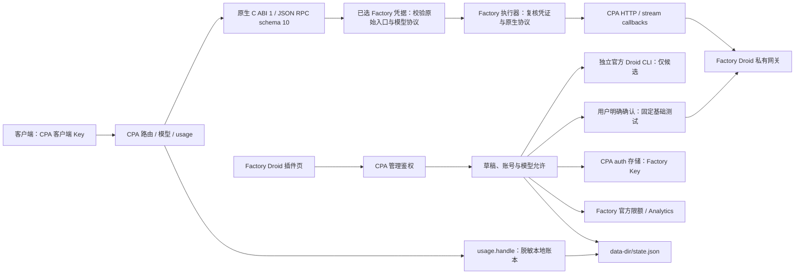

# 架构与数据说明

插件 ID / provider 为 `factory-droid`。Rust 包为 `cpa-factory-droid`，库 target 为 `cpa_factory_droid`，打包后重命名为 `factory-droid.dll` 或 `factory-droid.so`。

## 请求与存储

新建先验证身份并建立内存草稿，Key 在草稿提交前不写 CPA auth 文件。提交时通过 `host.auth.save` 保存凭据，再保存账号选择、验证和覆盖设置。零模型或待验证模型可以保存，但只发布有效允许集合。草稿最多 32 个、固定 30 分钟有效，停止或重启时清空。

插件 `state.json` 保存脱敏提示、身份、候选、允许意图、基础验证、账号覆盖、官方查询状态和账本，不保存完整 Key。`auth.parse` 只解析，避免宿主尚未成功保存时修改本地账号状态；合法导入文件沿用实际安全文件名，后续可管理。数据目录权限与 CPA auth 目录权限由部署者管理。

`model.static` 不发布无需凭据的模型。`model.for_auth`、guard、executor、固定账号 ID 和管理页共用有效集：账号启用且身份有效、全局路由启用、该账号允许、当前精确凭据/组织与路由的基础验证有效。旧定义没有对应验证记录时保留但不发布。共享和账号专属 ID 均使用显式配置的原生协议。

目录同步通过 provider-owned revision 触发宿主文件监听，并等待 `model.for_auth` 与 `host.auth.models` 的实际集合确认。`effective` 表示期望生效，`published` 表示 CPA 实际确认；5 秒内未确认返回 `catalog_refresh_incomplete`，保留待同步状态。reconcile 只补发布，不重复基础测试。账号别名仅影响专属 ID，四项账号价格覆盖不写全局。

## ABI 与生命周期

动态库导出 `cliproxy_plugin_init`，交换 `HostApi` / `PluginApi`。业务通过 JSON RPC envelope 传递；Go `[]byte` 字段按 Base64 编解码。宿主 callback 的返回缓冲区由宿主释放，插件返回缓冲区由插件释放，避免跨分配器释放。C 边界捕获 panic 并返回脱敏错误。

注册声明 auth、model、executor、quota、usage、management 和请求拦截能力。原生契约使用 RPC schema 10，宿主基线为 CPA v8.0.52；CGO 关闭的 CPA 不能加载这些原生动态库。

请求通过 `host.http.operation_open` 建立可取消操作，复用宿主 HTTP 与代理策略。流式执行先取得上游流和响应头，再由工作线程转发原生 chunks，并独立观察原生终态。超时仅取消本次 operation 及其绑定下游，不关闭其他并发请求。quiesce / shutdown 取消活动操作和发现进程，等待收尾；仍未结束时返回 draining 状态，不假装旧请求已完成。本机验收范围见 [验证记录](validation.md)。

## 候选发现与基础验证

`src/discovery.rs` 只运行管理员配置的官方原生可执行文件，以 `droid.list_models` 读取候选；不执行推理，也不分发 CLI。子进程环境清空用户 Factory、云、shell hook 等既有认证状态，使用本次私有 HOME / Factory 目录和 Key，禁用 keyring。完成、超时、取消及插件停止会回收进程树与隔离目录。

发现默认 30 秒，配置范围 10–120 秒；成功候选快照 5 分钟有效。上限为 1024 个候选、4 MiB stdout、256 KiB stderr、2 MiB 协议帧及 64 个通知。错误、过期或含敏感输出的结果不替代成功目录，也不回退静态目录冒充发现。无 CLI 可选择已有明确路由后手工测试。

基础验证由独立确认操作触发，每模型一次固定非流式短请求、最多 128 输出 token，超时不超过 60 秒。CLI 只提供 selection source；精确凭据和路由的完成状态、非空文本才形成 `factory_basic_call` 证据。测试记录为 `validation`，直接入账一次，不重复发布宿主 usage。候选明确禁用/弃用/custom/router 时拒绝验证。

发现和验证结果绑定操作代次，凭据/路由改变、撤销、删除或更新操作后，迟到结果不能重新允许模型。已发出的请求仍记录用量。详细使用与失败恢复见 [账号与模型管理](models.md)。

## 授权与管理页面

静态资源编译进动态库，资源前缀为 `/v0/resource/plugins/factory-droid`。资源只包含 HTML、JavaScript 和 CSS；所有账号及统计数据从受 CPA 管理鉴权保护的 `/v0/management/plugins/factory-droid` 接口获取。

页面优先复用当前同源管理器明确保存的会话，支持 `cli-proxy-auth` v1 / v2 编码，要求 `rememberPassword=true` 并检查 API 地址适用于当前 origin。未保存或无法复用时手工输入当前管理器密钥：直连 CPA 使用 CPA 管理 Key，CPAMP Full Mode 使用 Admin Key。插件不另行持久保存管理密钥。Factory Key 仅在新建表单填写；身份验证形成草稿，提交账号才持久化。API 不返回完整 Key。

当前 Key 路线不实现 OAuth 设备授权或 token 刷新。CPA 的 `auth_provider` / `executor_model_scope: oauth` 是宿主扩展路径名称，不表示插件已支持 Factory OAuth。`auth.login.start` 会指引用户打开插件管理页填写 API Key。

## 原生协议门禁

三种模型配置分别绑定原生入口：`anthropic` → `/v1/messages` / `claude`，`responses` → `/v1/responses` / `openai-response`，`chat_completions` → `/v1/chat/completions` / `openai`。协议来自显式配置，不从模型名称推断。

插件同时声明上述三种 input / output format，让标准三入口精确选择自己的格式；这不构成允许跨协议的声明。`request.intercept_after` 在已选凭据和解析模型之后检查转换前 `SourceFormat`、`ToFormat`、所选 Factory auth、实际模型和请求路径。错配通过正常 RPC 结果中的显式终止响应返回 HTTP 400 `protocol_mismatch`，不发送 Factory 请求。

由于宿主会在普通 interceptor RPC 错误时继续请求，仅抛出错误不能作为门禁。匹配的 Factory 请求会取得绑定本次 auth / model / 原始格式 / stream / 路径的一次性内部校验凭证；executor 在任何 Factory HTTP 之前复核该凭证、输入格式、输出格式、路径与凭据。凭证最多 4096 项、有效期 60 秒，不落盘；缺少、过期或不匹配时拒绝执行，内部凭证不转发给 Factory。其他 provider 不受 Factory 模型规则约束。

匹配时在同一协议内保留 JSON、工具 ID、签名、redacted / encrypted 内容、cache_control、usage 与原生 SSE，不重建为其他协议。只调整 Factory 必需的上游模型、Droid identity / system / instructions、认证/路由头，以及注册表明确要求的 Fast / Ultra Fast 参数；与快速模式冲突的客户端参数明确报错。检查已有 stream 值与宿主执行方式一致；流式执行且原生 stream 缺失或为 null 时补为 true。工具历史由客户端按原协议完整提供。图片能力仍由模型配置 `supports_images` 声明。

CPA v8.0.52 有两项明确边界：所有插件 hook 之前可能把误投 Chat 入口的 Responses 形状 body 改成 Chat并丢弃原文；Chat event-first 自定义 SSE 帧会被内置 normalizer 和 HTTP writer 再包装，改变事件类型与 data 语义。标准 Chat data 帧正常。宿主还可能调整 model、thinking、payload rules 和 usage details。原生插件 ABI 无开关绕过上述 Chat writer，本项目不改宿主，不能承诺全 SSE 或端到端字节透明。完整范围见 [原生协议与调用限制](protocol.md)。

## 网络边界

添加或刷新账号时调用 whoami，读取 region、组织和 `premBaseHostV2`。Factory 返回的主机也经过域名校验；默认只允许 Factory HTTPS 域名。开发时需显式启用 `allow-local-mock` 才允许 localhost / 127.0.0.1 / ::1，不能用任意公网 URL 替代上游。

认证失败、模型权限错误、请求过大和限流分别保留相应 HTTP 错误语义；不把所有 403 认定为 Key 失效。已开始输出的流不应透明重放，避免重复输出或工具执行。此接口依赖私有 Droid 契约，客户端身份、请求头、模型路由和数据结构可能随上游变更。

## 三种数据口径

| 数据 | 来源 | 持久化与未知状态 |
| --- | --- | --- |
| 官方滚动限额与额外余额 | Factory billing limits | 保存来源、检查时间及可读取状态；未识别字段不填零 |
| 官方 FSC 已用 | Factory 个人 Analytics | 保存 UTC 查询窗口；无套餐或角色权限时为不可读取 |
| 本地加权 token / USD 估算 | CPA `usage.handle` | 请求 ID 去重，失败与缺少 usage 单独处理，保留最近 400 天 |

宿主从执行结果解析业务 usage，再分发给插件；插件只处理 provider `factory-droid` 的事件。基础验证直接入账为 `validation`，与业务 `inference` 区分，不再重复发布用量，也不消费 `usage-queue`。账本不保存请求或响应正文。

本地账本把 input 归一化为包含缓存读取和写入的口径：Anthropic 原始 input 不含这两项，记账时加入一次；Responses / 标准 Chat 的 input 已含缓存子集，不再重复加入。旧账本已归一化的记录保持原值。reasoning 已含于 output。加权 token 和美元估算分别处理未缓存输入、缓存读取、缓存写入及输出；实际发生某类 token 但缺少对应单价时金额保持未知。配置变更影响新账本记录，不重新定价历史请求。

预算是全部账号业务和验证消耗的参考值，不重复套用到单账号，不是官方余额或强制限流。请求类型筛选不改变预算总口径；成功记录缺 usage 时，预算剩余为未知。默认窗口为 UTC 自然月，自定义窗口明确记录起止时间。

`src/quota_window_usage.rs` 按明确账号/池和官方半开窗口生成 `period_stats`，不使用全局报表窗口代替。池只取 `factory_registry` 或 `explicit_config`；旧无可信来源记录迁移为 unknown。周期 M 来自已测得原始 input + output，费用区分已知部分与完整金额；边界 unknown / expired 时数字为 null，连续覆盖 partial 与 usage / cost 完整性分别展示。

v2 预测仅差分相同 account / pool / window key / 精确 start/end / ledger epoch 的快照。比例至少变化 0.5 个百分点、至少 100 原始 token，且区间无缺 usage / 未知池等异常时才推算；USD 还要求该区间无缺价，区间外旧缺价不污染新样本。保留最近 40 天、最多 12,000 条快照；账本保留 400 天，裁剪后更换代次，旧样本不混用。完整字段和未知语义见 [用量、窗口与估算](usage.md)。

Analytics 按 UTC 日、含首尾日期接口查询；将插件半开区间转换后按最多 90 天分段，并截止今天。子日自定义窗口、早于 2026-01-14 的起点、非法/重复/越界日期或任一失败分段不冒充完整消耗。

## 持久化与并发范围

`Store` 使用进程内互斥状态，按请求 ID 去重；写临时 JSON、同步后原子替换 `state.json`，Unix 文件权限为 0600。数据目录错误返回失败并报告健康状态，不静默丢弃账本或把旧状态伪装保存成功。没有多进程文件锁，一个 `data-dir` 不能供多个 CPA 实例并写。

管理变更短时串行；网络发现、基础验证及业务请求可并发，使用代次及取消标识抵御旧结果覆盖。请求去重不取消用户重复主动发出的测试消费。每次记录持久化整个 JSON，账本规模影响写盘成本；没有数据库级多实例事务或未经测量的吞吐保证。

## 管理端与安装限制

CPA 官方管理前端有通用插件菜单和 quota 渲染；第三方管理端是否消费相同扩展需分别核查。`seakee/CPA-Manager-Plus v1.14.10` 的原生 quota 卡片按固定 provider 实现，Factory 额度在本插件页面展示。通用 CPA usage 不依赖该卡片。

商店注册表采用 CPA schema 1。ZIP 名遵循 `factory-droid_<version>_<goos>_<goarch>.zip`，动态库必须位于 ZIP 根目录，Release 提供校验和。当前流水线仅覆盖 Windows x64 与 Linux x64。注册表是安装描述，不能代替实际 Release 的存在。

Windows DLL 使用 MSVC 动态运行库，依赖 `VCRUNTIME140` / UCRT；安装环境需要 x64 Microsoft Visual C++ v14 Redistributable，版本不低于构建工具集 MSVC 14.44。Linux 在 Ubuntu 22.04 构建，CI 使用 `scripts/check-linux-runtime.mjs` 调用 `readelf`，断言最高 GLIBC 导入版本不超过 2.35。

构建期间按源码指纹检查输入是否变化。ZIP 最终摘要放在包外的 `.build.json`、`.sha256` 与 `checksums.txt`；包内 `SHA256SUMS.txt` 只记录动态库摘要，避免文档嵌入 ZIP 自身哈希形成自引用。
