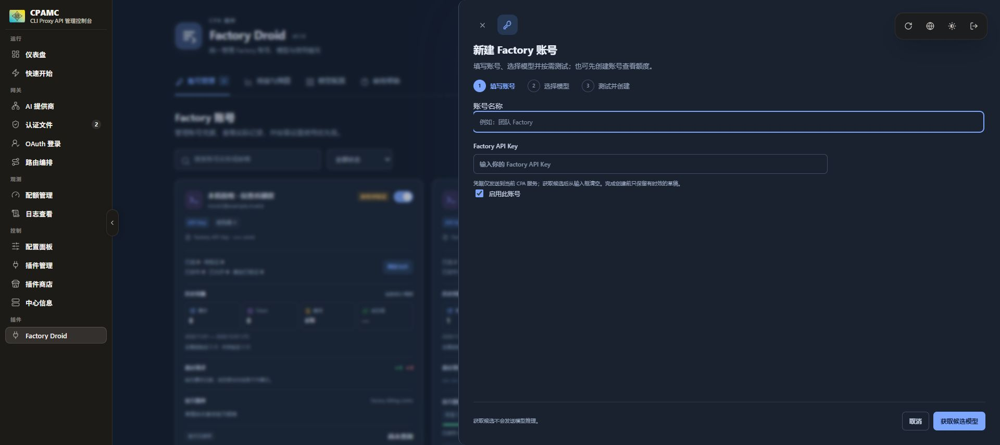
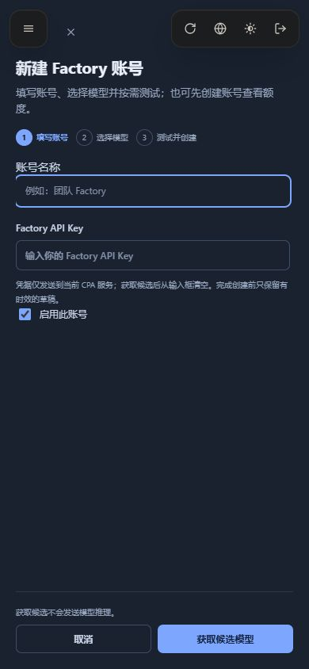
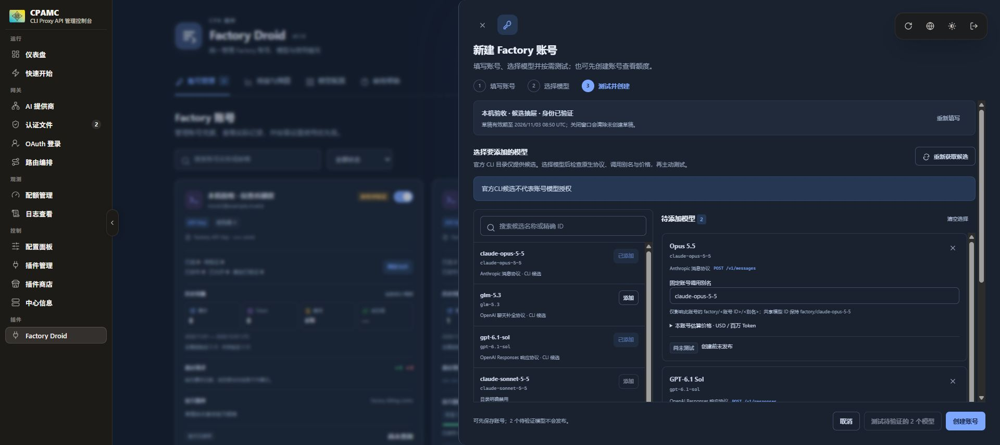

# Factory Droid 前端宿主验收

验收日期：2026-11-03。

> 本文及下方宿主截图保留的是 1040px 三步抽屉的历史验收。当前界面已改为约 640px 连续表单和紧凑额度行；最新 ZIP 的安装、健康与资源指纹核对通过，获取候选、测试和创建流程尚未完整验收。当前结论见 [本机集成验证记录](validation.md)，以下通过结果不能替代新版完整交互验收。

本次从本机 CPA 实际安装的插件 ZIP 打开管理中心，经侧栏「Factory Droid」进入宿主提供的 iframe，再点击「新建」。未使用合成宿主页或静态预览替代该项验收。Factory 请求仅进入本机模拟服务。

## 安装与资源

- CPA 管理中心：`http://127.0.0.1:60892/management.html`。
- 宿主路由：`#/plugin-pages/factory-droid/0`。
- iframe：`/v0/resource/plugins/factory-droid/index.html`。
- 实际运行插件健康状态：`ready`。
- 已安装 DLL SHA-256：`91473c6a75af919f05c8d1c253006a1e2379ca0b556f8265ff02986ffcdb1e24`。
- `app.js` SHA-256：`0e10eb99bc3c1a138a480a7cf67d1228ea03b4cc6e440647f618c891b683b0af`。
- `style.css` SHA-256：`ef885c1b4cba62d4556c295d8323aedb591c9f4afc5c2275c47b0e282910ca3f`。
- `index.html` SHA-256：`48576027707390c23a37d04dc9cd8e6a8532931829c905e1310d600ac80ab4a4`。

HTTP 返回的三份前端资源已与当前源文件逐字比对。安装包及宿主安装证据见本次集成验收记录；文档重封不改变上述代码与 DLL。

## 抽屉与键盘

| 检查 | 实测结果 |
| --- | --- |
| 桌面宿主视口 | `1920 × 855` |
| 桌面 iframe | 左侧 `216px`，右侧 `1920px`，高度 `855px` |
| 桌面抽屉 | 宽 `1040px`，高 `855px`，全局右边缘精确为 `1920px`，无背景滚动条造成的右缝 |
| 桌面底部操作 | 底边 `827px`，始终处于视口内 |
| 移动宿主视口 | `390 × 844` |
| 移动抽屉 | 左边 `0px`，右边 `390px`，高 `844px` |
| 移动底部操作 | 底边 `824px`，始终处于视口内 |
| 移动关闭按钮 | 横向 `72–106px`，避开宿主左侧菜单和右侧工具栏；鼠标点击关闭成功 |
| 初始焦点 | 桌面、移动端均为 `account-label` |
| 鼠标关闭与 Esc | 关闭后焦点返回 `add-account`，Key 输入框为空 |

已在实际宿主中修正桌面背景滚动条的 `15px` 右缝，以及桌面、移动端宿主工具栏对关闭按钮的遮挡。

## 草稿与额度保护

在最终安装包的宿主抽屉中填写模拟凭据、获取官方 CLI 候选，并选择 Opus、GPT 两条明确原生路由，确认：

- 仍在同一个右侧抽屉内完成填写账号、选择模型、测试与创建的三步流程。
- 获取候选后，Factory Key 输入框立即清空。
- 两个所选模型分别显示唯一原生协议与端点；别名、账号独立价格入口保留。
- 未勾选额度消耗确认时，测试按钮禁用。
- 待验证模型可随账号保存，页面明确说明待验证模型不会发布。
- 通过实际鼠标点击底部「取消」后抽屉关闭、Key 清空；随后读取该草稿返回 `HTTP 404 / draft_not_found`。
- 本轮打开抽屉、获取候选、多选与取消没有新增推理。模拟服务累计仍为此前一条显式验证请求。

## 静态与授权检查

- `node --check web/app.js`：通过。
- `git diff --check`：通过。
- HTML 重复 ID、JavaScript 缺失目标 ID 检查：均为零。
- 当前会话恢复函数在纯内存环境验证 `plain / enc::v1:: / enc::v2::`：仅 `rememberPassword=true` 可恢复；`false`、字段缺失及其他 origin 均拒绝。共 `12 / 12` 通过，测试未修改浏览器持久存储。

## 实际宿主截图

